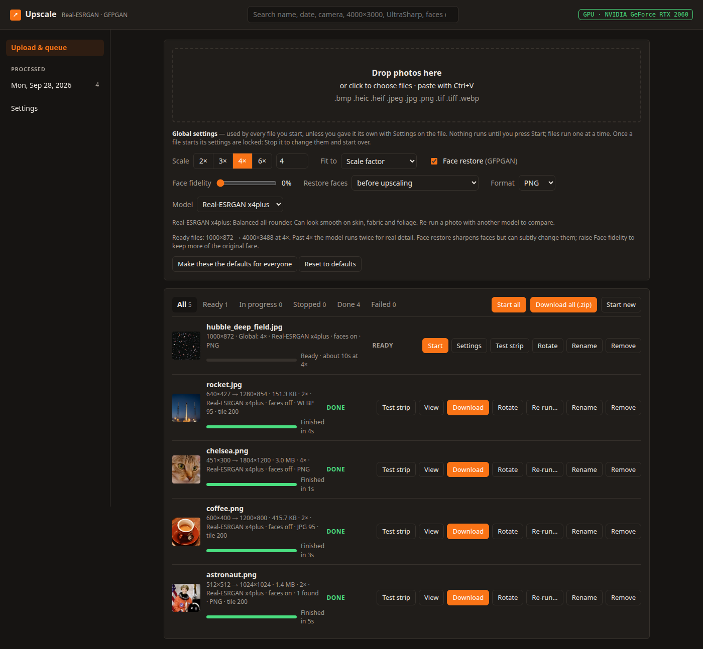
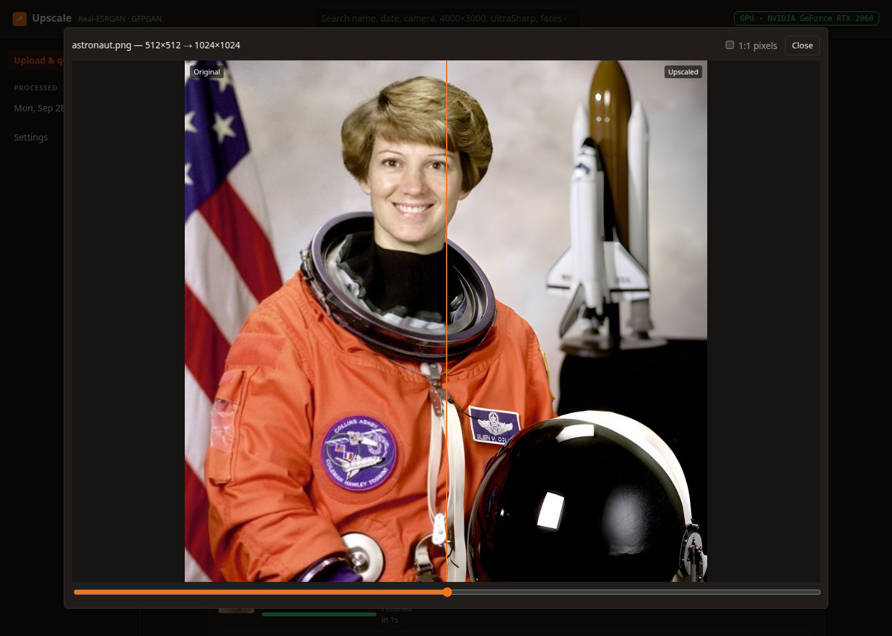
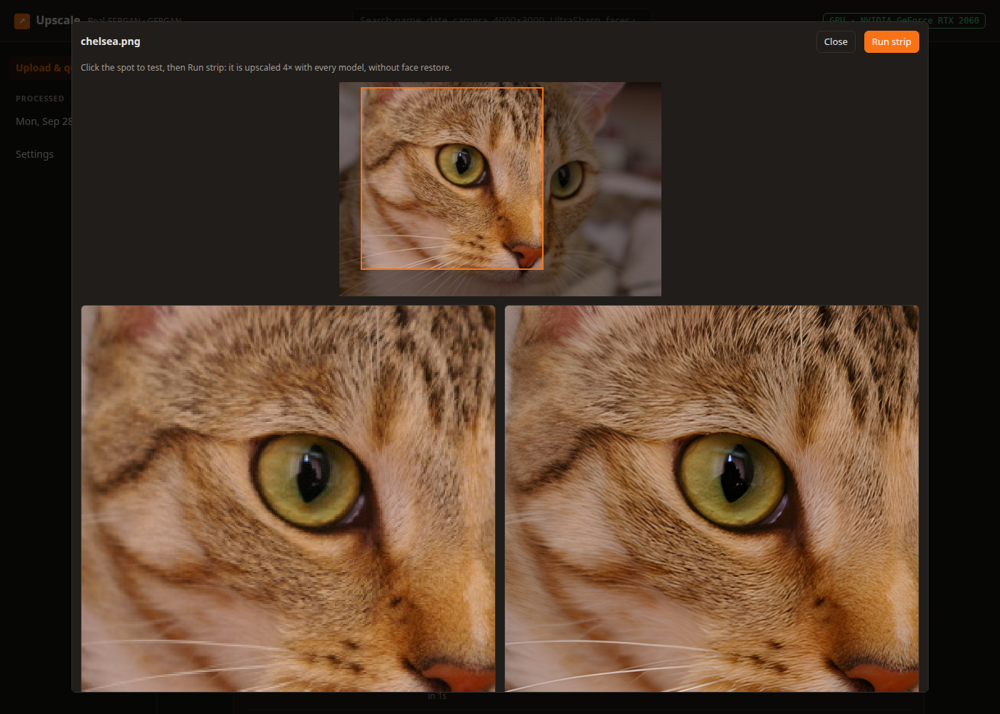
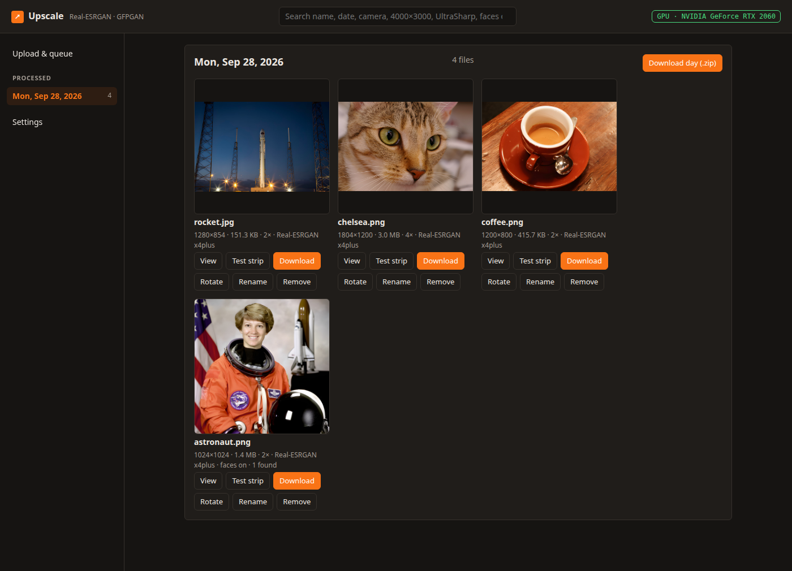
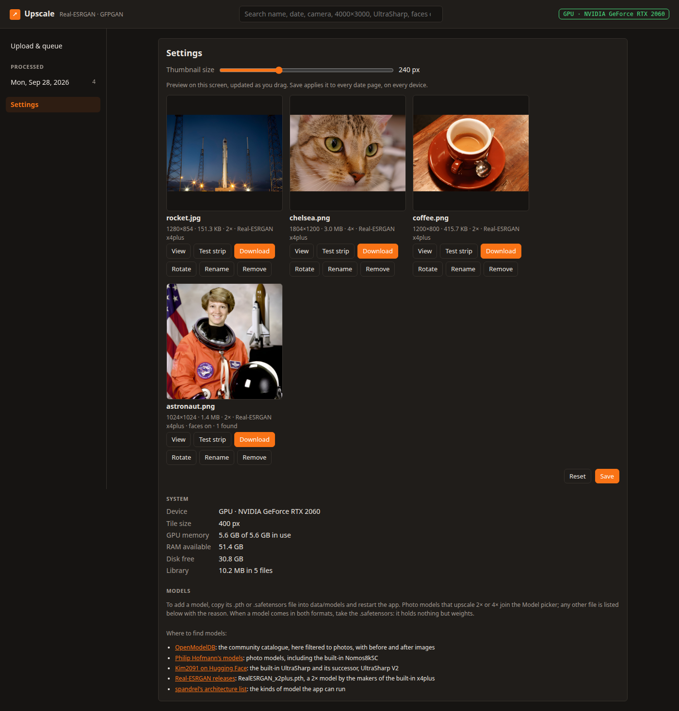

# Upscale

**Upscale photos in the browser, on your own NVIDIA GPU: Real-ESRGAN for detail, GFPGAN for faces**

Upscale enlarges whole photos (people, buildings, landscapes, text, fabric) up to 8× with Real-ESRGAN and other photo models, and can restore faces with GFPGAN. Add photos in the browser, try the models on the spot that matters with a test strip, and run them one at a time on the GPU. Originals, results and their history stay in one folder on your server. It runs as a Docker container on Linux with an NVIDIA GPU, fully offline: every model is inside the image.


---

## Screenshots

**Upload and queue** — photos wait as Ready until you press Start, then run one at a time, each with its settings, progress and time:



**View** — before and after, with a slider; "1:1 pixels" loads the full-size result:



**Test strip** — the spot you click, upscaled with every model in a few seconds, to choose one before a full run:



**Processed** — a page for each day, with every file finished that day:



**Settings** — thumbnail size, the GPU, memory and disk, and where to find more models:



*The photos shown are sample images that ship with scikit-image: public-domain photos from NASA and SpaceX, and CC0 photos.*

---

## Features

### Upscaling
- **Four built-in models** — Real-ESRGAN x4plus (balanced), UltraSharp (crisp edges and fine detail), Nomos8kSC (natural camera texture) and General v3, whose Denoise slider sets how much grain to keep.
- **Your own models** — copy a 2× or 4× photo model (`.pth` or `.safetensors`) into `data/models`, restart, and it joins the Model picker. Settings lists where to find more.
- **Any scale up to 8×, or Fit to a size** — 4K TV, 8K, a long edge in pixels, or a print in cm at 300 dpi; each file gets the scale it needs. Past 4× the model runs twice, for real detail instead of stretched pixels.
- **Test strip** — click the spot you care about (a face, text, fabric) and see it upscaled with every model in a few seconds.
- **Faithful results** — the colour profile, EXIF (date, camera) and orientation are kept, and 16-bit scans stay 16-bit as PNG. Save as PNG, JPG or WebP, with a quality slider.

### Faces
- **GFPGAN face restoration** — before upscaling, the classic order, or after, which also finds faces too small in the original.
- **Face fidelity** — mixes the plain upscale back into restored faces, up to 100%, when restoration changes how someone looks.
- **Counted** — each result says how many faces were restored.

### Queue and library
- **Nothing starts on its own** — added photos wait as Ready until you press Start, then run one at a time, with a progress bar and an estimate learned from this machine's own past runs.
- **Stop and Resume** — a stopped file keeps its progress, also across restarts and updates.
- **Checked before starting** — a result too wide for its format, or one that would need more RAM or disk than is free, stays Ready with the reason.
- **View, Re-run and compare** — a before and after slider; re-run a photo with other settings and compare the versions.
- **A page for each day**, **search** by name, date, camera, size, model or faces, and zip downloads.
- **Duplicates** — the same photo added twice is marked, and stored once.

### Adding photos
- **Drag and drop, pick or paste** (Ctrl+V): JPEG, PNG, WebP, BMP, TIFF, and HEIC/HEIF from phones, up to 400 megapixels.
- **Inbox folder** — photos copied into `data/inbox` by a scanner profile or a NAS job appear as Ready, or start by themselves.
- **Batch mode** — upscale a whole folder from the command line with the same engine, without the browser.

---

## Quick Start

### Docker (Linux with an NVIDIA GPU)

The host needs the NVIDIA driver and the NVIDIA Container Toolkit; see [Enabling the GPU](#enabling-the-gpu).

```bash
mkdir -p ~/upscale/data && cd ~/upscale
wget https://raw.githubusercontent.com/aiulian25/upscale/main/docker-compose.yml
docker compose up -d
```

Create the `data` folder before the first start, as above, so it belongs to you (`PUID`/`PGID`). Open **http://&lt;server-ip&gt;:47291** from any machine on your network. It is ready when the badge at the top right turns green and names your GPU.

> **Just pull, never build.** `ghcr.io/aiulian25/upscale:latest` is a ready-made `linux/amd64` image. It is large, about 15 GB unpacked, because PyTorch, CUDA and every model are inside.

### Enabling the GPU

Install `nvidia-container-toolkit` from NVIDIA's repository ([install guide](https://docs.nvidia.com/datacenter/cloud-native/container-toolkit/latest/install-guide.html)), then:

```bash
sudo nvidia-ctk runtime configure --runtime=docker
sudo nvidia-ctk cdi generate --output=/etc/cdi/nvidia.yaml
sudo systemctl restart docker
docker run --rm --gpus all ubuntu nvidia-smi   # must print the card
```

Without an NVIDIA GPU, delete the `deploy:` block in `docker-compose.yml`. The app then runs on every CPU core but one, much slower: a small group photo at 4× with face restore takes about a minute and a half on a 12-thread CPU.

### Updating

```bash
docker compose pull && docker compose up -d
```

Everything in `./data` stays, and files that were running carry on where they stopped.

---

## Supported Platforms

| | |
|---|---|
| Docker image | `ghcr.io/aiulian25/upscale`, `linux/amd64` |
| Docker | Engine 20.10 or newer, with Compose v2 (`docker compose`) and the NVIDIA Container Toolkit |
| GPU | NVIDIA, from the GTX 900 series to the RTX 40 series, and data-centre cards up to Hopper |
| Driver | NVIDIA 525 or newer (the image uses CUDA 12.6) |
| Without a GPU | Any x86-64 CPU, much slower |

The RTX 50 series (Blackwell) is not supported yet: this image's PyTorch has no code for it. There are no arm64 builds.

---

## Using it

1. **Add photos:** drag them onto the drop area, click it to pick files, or paste one with Ctrl+V.
2. **Choose the settings** in the Global settings panel: scale or Fit to, model, face restore and format. **Settings** on a file gives it its own.
3. **Not sure which model?** Press **Test strip** on a file, click the spot you care about, then **Run strip**, and use the model that looks best.
4. **Press Start** on a file, or **Start all**. Files run one at a time; **Stop** pauses one and keeps its progress, **Resume** continues it.
5. **View** compares before and after. **Download** one file, or **Download all (.zip)**. Finished files stay under **Processed**, a page for each day, until you **Remove** them.

**Make these the defaults for everyone** saves the Global settings as the starting point for every browser. Search, at the top, finds files by name, date (`2026-09-24`, `September`), camera, size (`4000x3000`), scale (`4x`), model, `faces on`, `faces found 2`, format or status.

### Inbox folder

Photos copied into `data/inbox/` appear as Ready with the shared defaults, as if dropped on the page, and their rows say "from inbox". A file is taken once it has stopped changing, one at a time, oldest first. The app moves each file out, so the folder must be writable by `PUID:PGID`. Hidden files, links and folders are left alone, so a copy still in progress under a temporary name is not taken early. A file that isn't an image goes to `data/inbox/rejected/`. With `INBOX_AUTOSTART=1` each file starts by itself, and the next is taken once it has finished.

### Custom models

Copy a model's `.pth` or `.safetensors` file into `data/models/` and restart (`docker compose restart`). A photo upscaling model that works 2× or 4× per pass on colour images joins the Model picker under its file name, and the test strip runs it too. **Settings → Models** lists every file left out, with the reason. When a model comes in both formats, take the `.safetensors`. Files must be readable by the container's user (`chmod a+r data/models/*`). Where to find models:

- [OpenModelDB](https://openmodeldb.info/?t=photo): the community catalogue, here filtered to photos, with before and after images; pick a 2× or 4× model
- [Philip Hofmann's models](https://github.com/Phhofm/models/releases): photo models, including the built-in Nomos8kSC
- [Kim2091 on Hugging Face](https://huggingface.co/Kim2091): the built-in UltraSharp and its successor, UltraSharp V2
- [Real-ESRGAN releases](https://github.com/xinntao/Real-ESRGAN/releases): `RealESRGAN_x2plus.pth`, a 2× model by the makers of the built-in x4plus
- [spandrel's architecture list](https://github.com/chaiNNer-org/spandrel#model-architecture-support): the kinds of model the app can run

### Batch mode (no browser)

Upscales every image in `./input` into `./output` with the page's own engine, starting from the page's shared defaults:

```bash
mkdir -p input output   # originals in ./input
docker compose run --rm -v ./input:/input:ro -v ./output:/output --entrypoint run.sh upscale --model 4x-UltraSharp --scale 6 --format jpg
```

Options: `--scale 6` or `--long-edge 3840`, `--model` (any in the picker), `--denoise 0.5`, `--format png|jpg|webp`, `--quality 85`, `--faces` or `--no-faces`, `--face-fidelity 0.5`, `--face-pass after` and `--tile 200`; `--help` lists them. A file the page would refuse, or one that can't be read, is reported as skipped and the rest carry on, with exit code 1 at the end. Results made this way don't show on the page; to keep them there, copy the photos into `data/inbox/` instead.

### Tips

- **For a 4K TV**, choose Fit to → 4K TV: each photo gets the scale that brings its long edge to 3840 px.
- **Scan prints at 600 dpi** (1200 for small prints). It matters more than any model.
- **Check faces.** GFPGAN makes faces much sharper, but it can subtly change how someone looks. Re-run with face restore off and compare, or raise Face fidelity to 30–60% to keep more of the original face.

---

## Configuration (Docker)

### Environment variables

| Variable | Default | Meaning |
|---|---|---|
| `PUID` / `PGID` | `1000` | The user and group that own everything in `./data` (`id -u`, `id -g`). Set them in a `.env` file next to `docker-compose.yml`; see [.env.example](.env.example) |
| `SCALE` | `4` | The scale each new browser starts with, from 1 to 8 |
| `FACE_ENHANCE` | `1` | Face restore at the start: `1` on, `0` off |
| `OUTPUT_FORMAT` | `png` | `png`, `jpg` or `webp` |
| `OUTPUT_NAME_TEMPLATE` | `{name}_upscaled` | Download names. Also `{scale}`, `{model}`, `{faces}` and `{date}`, the day it finished (UTC): `{name}_{scale}_{model}` gives `photo_8x_4x-UltraSharp.png` |
| `INBOX_AUTOSTART` | `0` | `1` starts each photo copied into `data/inbox` by itself, one at a time |
| `TILE` | `400` | Tile size in pixels. When a file runs out of GPU memory, the app halves it for that file by itself, down to 100 |
| `CPU_CORES_RESERVED` | `1` | Without a GPU, the cores kept free for the rest of the machine. Batch mode uses them all |

The starting settings apply until someone saves defaults on the page. An invalid value stops the app at start with a clear error in `docker logs upscale`.

### The data folder

```
data/
├── inbox/            # copy photos here; rejected/ gets files that aren't images
├── models/           # extra .pth and .safetensors models, read at start
├── input/            # the originals
├── output/           # the results
├── preview/          # smaller copies for the browser
├── checkpoints/      # the progress of stopped files, so Resume works after a restart
├── jobs.json         # the list of files, with their settings and history
└── preferences.json  # thumbnail size and the shared defaults
```

Back up this folder to keep everything. Don't copy files into `data/input/`: files there that no entry owns are deleted at the next start.

### Port

`47291`. Publish it as `"127.0.0.1:47291:47291"` to keep the app on the server only.

---

## Security

- **No login.** Anyone who can reach the port can upload photos, and see, download, rename and remove every file. Use it on a trusted network, or put a reverse proxy with HTTPS and a login in front of it.
- **Other websites are kept out.** A request that changes something (upload, Start, Stop, settings, Rename, Remove) or builds a zip is refused when a page on another site makes the browser send it. Behind a reverse proxy current browsers need nothing; for older ones, the proxy should pass the original `Host` or `X-Forwarded-Host` header.
- **Offline.** Every model is inside the image, and the app makes no outgoing connections: no telemetry, no update check.
- **Locked down.** The container runs as `PUID:PGID`, not root, with no Linux capabilities and `no-new-privileges`, and keeps its files in `/data`.
- **Models can't run code.** A `.pth` file is read with an unpickler that only rebuilds tensors, so a file carrying code is refused; `.pt`, `.ckpt` and `.onnx` files are never read.
- **Broken files stay contained.** Images over 400 megapixels are refused, and HEIC/HEIF photos are decoded in a separate process.

---

## Troubleshooting

- **`could not select device driver "nvidia" with capabilities: [[gpu]]`** — the NVIDIA Container Toolkit is missing, or Docker wasn't restarted after installing it; see [Enabling the GPU](#enabling-the-gpu). Without an NVIDIA GPU, delete the `deploy:` block in `docker-compose.yml`.
- **The container keeps restarting, and `docker logs upscale` shows `Permission denied` for `/data`** — give the folder to `PUID:PGID`, for example `sudo chown -R 1000:1000 data`.
- **An RTX 50 series card** — not supported yet; see [Supported Platforms](#supported-platforms).
- **Out of GPU memory** — the app halves the tile size by itself and starts the file over. If files still fail, close other programs that use the GPU, or set `TILE` lower.
- **Start leaves a file Ready with a reason in red** — the result would be too wide for WebP (16383 px) or JPG (65535 px), or would need more RAM or disk than is free. Choose another format or a smaller scale, or free some space.
- **A custom model is missing from the picker** — Settings → Models says why. Restart after copying models, and make them readable: `chmod a+r data/models/*`.
- **The container shows `(unhealthy)`** — `curl -s localhost:47291/health` gives the reason, and `docker logs upscale` the details.

---

## What's New

### v1.0.0

The first public release.

- **A ready-made image.** Pull `ghcr.io/aiulian25/upscale` and run it with Docker Compose on an NVIDIA GPU. Every model is inside, so it runs offline.
- **Four built-in models, and your own.** Real-ESRGAN x4plus, UltraSharp, Nomos8kSC and General v3 with a Denoise slider, plus any 2× or 4× photo model copied into `data/models`. The test strip compares them on the spot that matters.
- **Faces restored with GFPGAN**, before or after upscaling, with a fidelity slider to keep more of the original face.
- **A queue that keeps going.** Stop and Resume, settings for each file, and estimates from this machine's past runs; files that were running carry on after a restart or an update.
- **Phone photos and scans.** HEIC/HEIF, 16-bit PNG and TIFF, up to 400 megapixels, with the colour profile, EXIF and orientation kept.
- **Inbox folder and batch mode** for scanners, NAS jobs and scripts.

---

## License

MIT — see [LICENSE](LICENSE). The image also holds third-party code and models under their own licences:

| | |
|---|---|
| [Real-ESRGAN](https://github.com/xinntao/Real-ESRGAN), with its x4plus and General v3 models | BSD 3-Clause |
| [GFPGAN](https://github.com/TencentARC/GFPGAN) and its model, [BasicSR](https://github.com/XPixelGroup/BasicSR) | Apache 2.0 |
| [facexlib](https://github.com/xinntao/facexlib), [spandrel](https://github.com/chaiNNer-org/spandrel) | MIT |
| [4x-UltraSharp](https://huggingface.co/Kim2091/UltraSharp) by Kim2091 | CC BY-NC-SA 4.0, which does not allow commercial use |
| [4xNomos8kSC](https://github.com/Phhofm/models/releases/tag/4xNomos8kSC) by Philip Hofmann | CC BY 4.0 |
